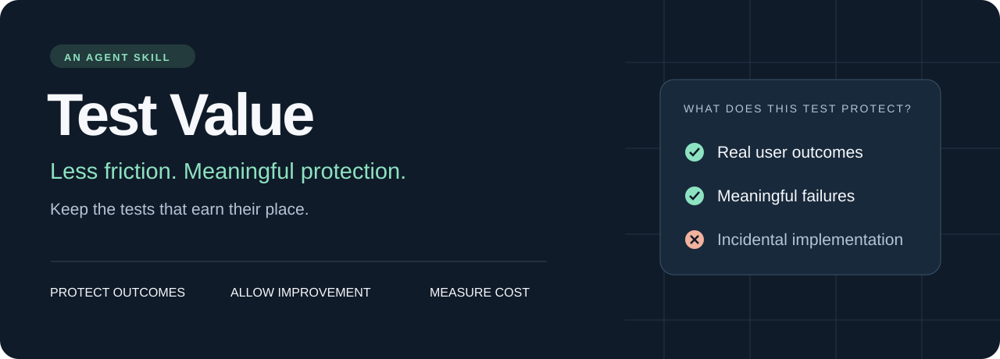

<p align="center">
  
</p>

<p align="center">
  <a href="SKILL.md">Read the skill</a> ·
  <a href="#install">Install</a> ·
  <a href="#use-it">Use it</a> ·
  <a href="CONTRIBUTING.md">Contribute</a>
</p>

# Tests should earn their place.

AI can generate tests faster than a team can maintain them. The result can be a growing collection of slow matrices, brittle snapshots and assertions that reject perfectly good refactors.

**Test Value** is a reusable agent skill for deciding which tests to add, keep, improve or retire. It helps agents protect real behavior while reducing feedback time and maintenance friction.

> What concrete mistake does this test catch — and is that protection worth its cost?

## Three moments to use it

| When | What the skill helps decide |
| --- | --- |
| **While implementing** | Extend existing coverage, add a focused regression, or add no new test when protection already exists. |
| **Before a commit or PR** | Check the tests affected by the change, identify brittle assertions and choose proportionate verification. |
| **When tests become a burden** | Investigate slow, flaky or redundant tests and make evidence-backed improvements in batches. |

Reviewing tests does not authorize committing, pushing or changing release requirements. Ordinary use stays scoped to the task.

## Install

Using the [Skills CLI](https://github.com/vercel-labs/skills):

```sh
npx skills add tt-a1i/test-value --skill test-value
```

Choose the target agent and installation scope in the installer. To inspect the available skill without installing:

```sh
npx skills add tt-a1i/test-value --list
```

For manual installation, place this repository's skill directory in the location your agent uses for skills. Preserve `SKILL.md`, `references/` and, for Codex UI metadata, `agents/`. Agent discovery and invocation behavior depend on the host; this repository provides Markdown guidance, not a test runner or Git hook.

## Use it

In Codex, invoke it explicitly with `$test-value`. In other skill-capable agents, request the skill by name using the host's supported invocation method.

**Improve an existing suite**

```text
Use $test-value to investigate the slow and brittle tests in this project.
Implement justified improvements, preserve core behavior, and report the
coverage tradeoffs and measured results. Keep changes local.
```

**Review the tests for a change**

```text
Use $test-value to review tests relevant to this diff before I commit.
Identify missing protection, redundant checks and assertions that would
reject an equivalent refactor. Do not commit or push.
```

**Design a regression**

```text
Use $test-value while fixing this bug. Find the cheapest test that exposes
the actual failure, reuse existing fixtures where appropriate, and confirm
that the test distinguishes the broken behavior from the fix.
```

## The philosophy

**Correctness needs an independent basis.** An implementation and a test generated from that implementation can agree and still be wrong. Start from user requirements, public contracts or observed failures.

**Protect outcomes; allow valid improvements.** A clearer automatic route should not fail because its intermediate bends moved. User-authored geometry and promised protocol bytes may still require exact checks.

**Count the whole cost.** Runtime, false-alarm investigation, fixture upkeep, blocked refactors and repeated verification all matter. A rare data-loss regression can be worth more than hundreds of fast but redundant assertions.

**Require evidence for cuts as well as additions.** Identify which remaining test catches the original mistake. When relaxing an assertion, check that a valid alternative passes and the bad result still fails.

**Verify in proportion to risk.** Reuse applicable evidence and run affected checks. Confirm that intended tests actually executed; zero collected tests and skipped environments are not proof of correctness.

## What changes in practice?

| A maintenance burden | A better decision |
| --- | --- |
| A snapshot freezes every automatic layout coordinate | Check attachment, direction and obstacle avoidance; retain explicit constraints. |
| Every entrypoint repeats the same shared rule matrix | Cover shared rules and each entrypoint's integration, retaining combinations with distinct handling. |
| A release test searches source code for required filenames | Exercise missing-input behavior, or reuse an existing check that already does. |
| A flaky test turns green after retries | Investigate readiness, isolation and product races; distinguish quarantine from a pass. |
| Every small edit triggers another full run | Select checks by impact and reuse results that remain applicable. |

These are decision examples, not blanket deletion rules. The skill preserves effective protection for data integrity, trust boundaries, compatibility, accessibility, cleanup and recovery. It does not pursue a test-count target or prescribe a universal time budget.

## Learn from real use

Agents may refine the skill when an observed failure or useful counterexample reveals a missing principle. Each refinement should explain what decision improves, when it applies and where it does not.

Prefer revising an existing principle to accumulating rules. Agents must tell the user what changed, why, and where it was saved. Local learning does not automatically publish or synchronize changes.

## Inside the skill

| File | Purpose |
| --- | --- |
| [SKILL.md](SKILL.md) | Scope, decision process, safeguards and learning from use. |
| [Audit guide](references/audit.md) | Cost mapping, reduction evidence and execution by risk. |
| [Decision examples](references/decision-examples.md) | Concrete cases and common traps. |
| [Codex metadata](agents/openai.yaml) | Display name, default prompt and implicit-invocation setting. |

Developed from hands-on test maintenance in [Archify](https://github.com/tt-a1i/archify). The guidance has received independent agent review and scenario-based review; broader effectiveness remains something to establish through real use.

Contributions should bring a concrete failure, counterexample or maintenance improvement. See [CONTRIBUTING.md](CONTRIBUTING.md).

## License

[MIT](LICENSE).
