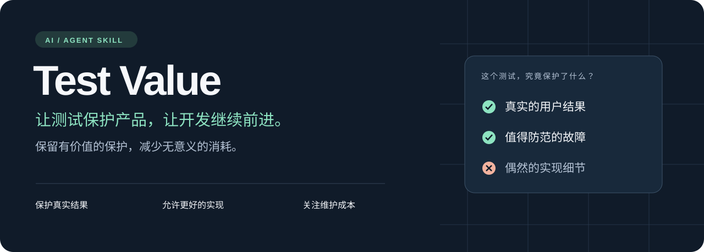

<p align="center">
  
</p>

<p align="center">
  <strong>简体中文</strong> · <a href="README_EN.md">English</a>
</p>
<p align="center">
  <a href="#快速开始">快速开始</a> ·
  <a href="#它能带来什么">它能带来什么</a> ·
  <a href="#背后的判断原则">判断原则</a> ·
  <a href="SKILL.md">阅读 Skill</a>
</p>

# AI 写测试很快，维护测试却很贵。

一次正常重构，让几十个测试变红；自动布局变得更清晰，却被旧坐标拦住；每次修改都重跑全量，时间不断消耗在等待和误报排查里。

**Test Value** 是一个面向 AI / Agent 的测试维护 skill。它帮助 Agent 在开发、提交前和存量治理中判断：哪些测试值得新增，哪些应该复用，哪些需要改写，哪些可以退役。

> **这个测试能抓住什么具体错误？这份保护，值得付出多少维护成本？**

它来自 [Archify](https://github.com/tt-a1i/archify) 的实际测试维护经历。目标是让测试持续保护产品，同时给合法重构、性能提升和更好的产品效果留下空间。

## 它能带来什么

| 你遇到的问题 | Agent 应该做出的改进 | 保留下来的价值 |
| --- | --- | --- |
| 每次小改动都跑完整测试 | 按影响选择检查，复用仍然有效的结果 | 与本次风险相称的反馈 |
| 同一规则在多个入口反复展开 | 验证共享规则全集，各入口检查实际接入 | 规则与入口差异仍有保护 |
| 测试绑定内部函数名或源码写法 | 改为验证输出、状态或真实失败边界 | 等价重构可以正常通过 |
| 自动输出一变，快照就失败 | 区分用户明确要求与算法自行选择的结果 | 更好的合法结果有改进空间 |
| 重试后变绿，但问题原因不明 | 调查就绪条件、隔离、清理与真实竞争条件 | 故障仍然可见 |
| AI 写的代码和测试一起犯错 | 从需求、公开契约或真实故障建立预期 | 测试有独立的正确性依据 |

**精简测试也需要证明。** 数据完整性、权限边界、兼容性、关键无障碍行为、资源清理和失败恢复的有效保护，都值得保留。罕见而严重的故障，可能比大量轻量断言更有测试价值。

## 快速开始

使用 [Skills CLI](https://github.com/vercel-labs/skills) 安装：

```sh
npx skills add tt-a1i/test-value --skill test-value
```

在安装器中选择目标 Agent 和安装范围。只想查看可发现的 skill：

```sh
npx skills add tt-a1i/test-value --list
```

Codex 中可以用 `$test-value` 显式调用。其他支持 skills 的 Agent，按宿主提供的方式调用 skill 名称。手动安装时，将 `SKILL.md`、`references/` 放入宿主的 skill 目录；Codex 界面信息位于 `agents/`。

Skill 的指令保持英文，README 提供中英两版。它提供可复用的判断方法，实际发现和调用方式由 Agent 宿主决定。

## 三种用法，直接复制

### ① 开发时：写一个真正能抓住错误的测试

```text
使用 $test-value 修复这个 bug。
先找已有测试能否覆盖，再选择成本最低、能暴露真实故障的回归用例。
确认坏结果会失败，修复后能通过。
```

### ② 提交前：审视这次改动，而不是扩大工作量

```text
使用 $test-value 审视当前 diff 涉及的测试。
指出缺失的保护、重复检查，以及会误拦等价重构的断言。
按风险选择验证。不要提交或推送。
```

### ③ 治理时：减少等待，也减少未来的维护负担

```text
使用 $test-value 调查这个项目里慢、脆弱或重复的测试。
分批落实有证据的改进，保留核心行为与真实失败边界。
报告实际收益、取消的组合和验证缺口。只改本地。
```

## 背后的判断原则

**正确性要有独立依据。** 代码和从代码生成的测试可以一致地犯错。需求、公开契约、兼容性样本与真实故障，才是建立预期的依据。

**保护结果，也允许改进。** 自动布局的中间拐点通常可以变化；用户明确指定的坐标、端口和路径仍然应被尊重。公开格式和确定性承诺也可能需要精确比较。

**计算完整成本。** 等待、误报排查、夹具维护、被阻碍的重构和反复验证，都有成本。测试数量和覆盖率不能单独说明收益。

**新增与删减，都用证据说话。** 放宽断言时，检查合法替代结果能否通过、原始错误是否仍然失败。删除重复项时，指出谁接管了保护。

**验证强度跟风险走。** 复用有效证据，按影响扩大检查。确认预期测试实际执行；误选零测试、环境跳过和模拟结果，各自有不同的证明范围。

## 从实际使用中继续成长

Agent 遇到有证据的新原则，可以改进 skill：说明观察到了什么、会改变哪个决策、适用于什么情况，以及有什么例外。

优先完善已有原则，避免不断堆叠规矩。每次更新后，Agent 必须告诉用户**改了什么、为什么改、文件在哪里、是否已保存**。本地学习不会自动发布或同步到其他安装。

## 内容与贡献

| 文件 | 内容 |
| --- | --- |
| [SKILL.md](SKILL.md) | 范围、决策方法、保护边界和从使用中学习 |
| [审计指南](references/audit.md) | 成本调查、删减证据和按风险执行 |
| [判断示例](references/decision-examples.md) | 自动布局、共享矩阵、源码断言、异步等待等案例 |
| [贡献说明](CONTRIBUTING.md) | 如何用真实问题和反例改进指导 |

Skill 已经过独立 Agent 审查和场景审查；跨项目效果仍需要在真实使用中验证。欢迎提供具体故障、反例或维护收益，让它变得更有用、更简洁。

<p align="center">
  <a href="LICENSE">MIT License</a> · <a href="README_EN.md">English version</a> · <a href="https://github.com/tt-a1i/test-value/issues">反馈与讨论</a>
</p>
